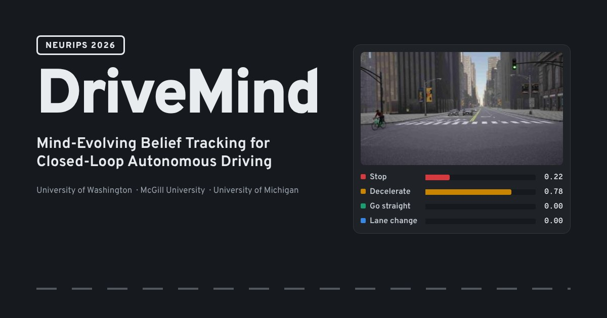

# DriveMind: Mind-Evolving Belief Tracking for Closed-Loop Autonomous Driving

**NeurIPS 2026**

Yan Shi<sup>1</sup>, Kehua Chen<sup>1*</sup>, Jiarui Qi<sup>1</sup>, Yihong Tang<sup>2</sup>, Haicheng Liao<sup>3</sup>, Yinhai Wang<sup>1*</sup>

<sup>1</sup>University of Washington · <sup>2</sup>McGill University · <sup>3</sup>University of Michigan · <sup>*</sup>Corresponding authors

**[Project page](https://qijiarui20021031.github.io/DriveMind/)** · **[Paper (PDF)](static/DriveMind_NeurIPS2026.pdf)** · **[arXiv](https://arxiv.org/abs/2610.32069)** · **[Code](https://github.com/shiyannacl/drivemind)**

[](https://qijiarui20021031.github.io/DriveMind/)

## Overview

Human drivers read intent. They guess what other road users are about to do and revise those guesses as the scene unfolds, an ability known as theory of mind. Multimodal LLM drivers, by contrast, usually reason from scratch at every frame and commit to a single interpretation of the scene, so when the scene is ambiguous they can act on the wrong one before the evidence arrives.

DriveMind gives an MLLM driver a mind that evolves in the same spirit. It keeps several natural-language hypotheses about the scene alive as a weighted belief, weighs each against every new camera frame, and keeps alternative explanations in play until the evidence settles them. A slow vision-language reasoner updates the belief at about 2 Hz, and a fast diffusion controller plans trajectories at about 10 Hz from the latest belief.

On Bench2Drive, adding belief tracking to the same driving pipeline raises the Driving Score from 68.50 to 81.37 and the success rate from 41.36% to 54.09%. The largest gains come in ambiguous scenarios such as oncoming traffic (+20.5 DS) and unsignalized intersections (+20.0 DS).

## Citation

```bibtex
@inproceedings{drivemind2026,
  title     = {DriveMind: Mind-Evolving Belief Tracking for
               Closed-Loop Autonomous Driving},
  author    = {Shi, Yan and Chen, Kehua and Qi, Jiarui and
               Tang, Yihong and Liao, Haicheng and Wang, Yinhai},
  booktitle = {Advances in Neural Information Processing Systems (NeurIPS)},
  year      = {2026}
}
```

## About this repository

This repository hosts the project page, a static site served by GitHub Pages. `index.html` contains the page together with its styles and scripts, `assets/` holds figures and camera frames from the paper, and `static/` holds the paper PDF.

To preview the page locally, run `python3 -m http.server` in the repository folder and open <http://localhost:8000>.
